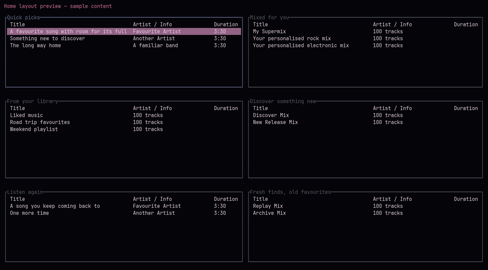

# ytmusic-tui — Omarchy edition

A keyboard-driven YouTube Music player with a practical desktop-friendly interface.

This is **lisim’s customised fork** of [WakaTaira/ytmusic-tui](https://github.com/WakaTaira/ytmusic-tui), based on upstream commit `09114f3076422756811c62889b605429df704813`. It is not an official upstream release. The original MIT licence and upstream history are preserved.



## What this edition adds

- **Home cards:** responsive two-column sections, longer titles and keyboard paging.
- **Visible shortcuts:** a contextual helper along the bottom; F1 hides/shows it.
- **Terminal colours:** choose `theme = "terminal"` to use your terminal palette.
- **Personal mixes:** later Home sections load, including Mixed for you. Personal mixes open promptly with their first batch of songs.
- **Desktop controls:** working MPRIS volume changes and upcoming-track metadata for the companion plugin.

It also retains the YouTube session timestamp cookies needed by some accounts when signing in from a browser, and creates authentication files with owner-only permissions.

## Use it with Omarchy

The [Omarchy YouTube Music plugin](https://github.com/lisim/omarchy-ytmusic) provides first-run setup, a choice of this edition or unmodified upstream, a floating show/hide window, playback controls, a vertical volume slider and an Up Next list.

## Build it yourself

You need a stable Rust toolchain, a C toolchain/pkg-config, libmpv and yt-dlp. On Arch/Omarchy:

```sh
omarchy pkg add rustup base-devel mpv yt-dlp
rustup toolchain install stable
git clone --branch omarchy https://github.com/lisim/ytmusic-tui.git
cd ytmusic-tui
cargo build --release --locked -p ytmusic-tui
```

Run `target/release/ytmusic-tui auth --from-browser chrome` (replace `chrome` with your browser), then `target/release/ytmusic-tui`. Manual sign-in is available with `target/release/ytmusic-tui auth`.

By default it uses `~/.config/ytmusic-tui/`. Set **`YTMUSIC_TUI_CONFIG_DIR`** to a separate directory to isolate configuration, keymaps and browser authentication from another installation. The companion plugin does this automatically for this edition. Existing explicit `browser_auth_path` overrides remain supported.

For terminal colours, put this in the selected directory’s `config.toml`:

```toml
[ui]
theme = "terminal"
```

`NO_COLOR` disables terminal colours. The companion launcher clears it for this interactive player.

## Essential keys

| Key | Action |
| --- | --- |
| 1 / 2 / 3 / 5 / 8 | Home / Search / Library / Queue / Lyrics |
| Tab / Shift+Tab | Next / previous card or pane |
| Up / Down, Enter | Select and play/open |
| Space, n / p, + / - | Pause, next/previous, volume |
| Esc, F1, Q | Back or leave search input, helper, quit |

After submitting a search with Enter, press Esc to browse its results. Mouse selection is not supported. Closing the terminal quits playback; the companion plugin’s hide action keeps it running.

## Limits and validation

Home loads at most ten pages. Personal `RDTMAK` mixes load the initial batch (typically 100 songs); regular playlists retain full pagination. Desktop Up Next publishes at most 100 upcoming songs, respecting shuffle and repeat. Helper labels assume the default keymap.

```sh
cargo test --release --locked --workspace
cargo fmt --all --check
cargo clippy --release --all-targets --locked -- -D warnings
```

This repository distributes source, not prebuilt players. See [DEPENDENCIES.md](DEPENDENCIES.md) before redistributing binaries. [Upstream documentation](README_UPSTREAM.md) describes the original player; some behaviour differs in this edition.

## Licence and credit

[MIT](LICENSE), copyright © 2026 WakaTaira. Keep the original copyright and licence notice when redistributing. Fork changes are maintained by [lisim](https://github.com/lisim); this project is not affiliated with Google or YouTube.
